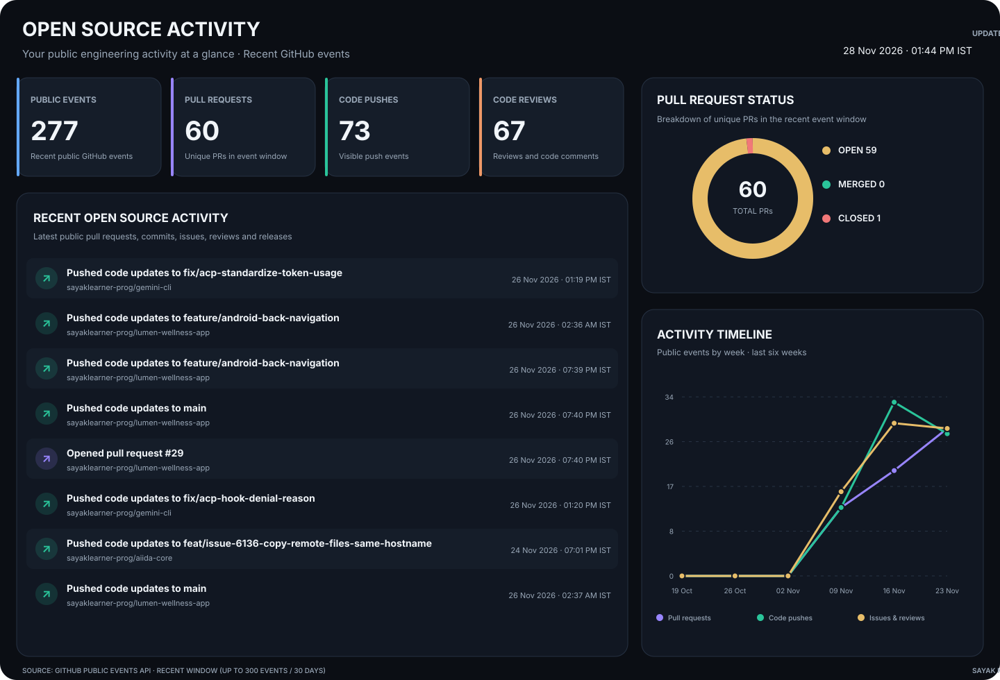

  

  
  
  
  

<h3 align="center">Building intelligent systems. Learning in public. Shipping real products.</h3>

  <a href="https://www.linkedin.com/in/sayak-mondal-101b3340a">LinkedIn</a> •
  <a href="mailto:sayaklearner@gmail.com">Email</a> •
  <a href="https://github.com/sayaklearner-prog">GitHub</a>

---

## 🧑‍💻 About Me

I'm a first-year undergraduate at **Jadavpur University, Kolkata**, passionate about building practical AI-powered systems.

I enjoy taking ideas from concept to production — experimenting with LLMs, designing agentic workflows, integrating APIs, and shipping real-world applications.

Currently focused on:

- 🤖 Agentic AI and Multi-Agent Systems
- 🧠 Large Language Models and LLM Infrastructure
- 🔗 Model Context Protocol (MCP) and Tool Orchestration
- 📚 Retrieval-Augmented Generation (RAG)
- 🌐 Open Source Development and AI Infrastructure

**My philosophy:** Learn by building. Improve by contributing. Ship what matters.

---

## 🚀 What I'm Building

### 🛡️ MailShield — AI-Powered Cybersecurity Intelligence

An email threat detection and digital forensics platform designed to identify phishing attempts, investigate suspicious URLs, analyze email evidence, and uncover potential cyber threats.

- Email threat detection and forensic analysis
- Domain, IP and URL intelligence
- Threat scoring and evidence-based investigations
- AI-assisted security interpretation

**Stack:** Python · TypeScript · FastAPI · Next.js · AI

### 💎 LUMEN OS — Personalized Health Intelligence

A personalized health and wellness platform that brings health data, AI-powered insights, and intelligent recommendations together.

- Health data integration and wearable connectivity
- AI-powered health insights
- Personalized experiences based on health conditions
- Condition-aware optimization for diabetes, pregnancy, hypertension and more

**Stack:** TypeScript · Python · AI · APIs

### ⚡ Gemini CLI — Open Source Contributions

Exploring Google's open-source AI agent and contributing to its development.

- Working with agent execution and tool orchestration
- Exploring CLI architecture and developer workflows
- Contributing fixes and improvements to the codebase

**Focus:** AI Agents · TypeScript · Developer Infrastructure

---

## 🌱 Open Source Journey

I believe open source is one of the best ways to become a better engineer.

Currently exploring and contributing to projects across AI infrastructure, LLM tooling, and developer ecosystems.

**Projects I'm exploring:**

- [Gemini CLI](https://github.com/google-gemini/gemini-cli)
- [vLLM](https://github.com/vllm-project/vllm)
- [Open WebUI](https://github.com/open-webui/open-webui)
- [DSPy](https://github.com/stanfordnlp/dspy)
- [Kubeflow](https://github.com/kubeflow/kubeflow)

**Recent contribution highlight**

- Gemini CLI — `fix(core): unify exit codes mapping and fatal error hierarchy`

My goal is to become a stronger open-source contributor and work towards **Google Summer of Code 2027**.

---

## 🧰 Technologies & Tools

  

  
  
  
  
  

**Currently Exploring**

Kubeflow · Agentic Workflows · LLM Evaluation · MLOps · AI Infrastructure

---

## 📊 GitHub Analytics

  
  

  

---

## 📈 GitHub Intelligence Dashboard

### Overview
<picture>
  <source media="(prefers-color-scheme: dark)" srcset="./assets/overview.dark.svg" />
  
</picture>

### Contribution Insights
<picture>
  <source media="(prefers-color-scheme: dark)" srcset="./assets/contributions.dark.svg" />
  
</picture>

### Coding Languages
<picture>
  <source media="(prefers-color-scheme: dark)" srcset="./assets/languages.dark.svg" />
  
</picture>

### Repository Activity
<picture>
  <source media="(prefers-color-scheme: dark)" srcset="./assets/repositories.dark.svg" />
  
</picture>

---

## 🌐 Open Source Activity Timeline

Recent public pull requests, commits, reviews, issues, and releases — refreshed automatically every day.

<!--START_SECTION:open-source-activity-->

<strong>View clickable recent activity</strong>

<table>
<tbody>
<tr><td align="center" width="38"><strong>↗</strong></td><td><a href="https://github.com/sayaklearner-prog/sayaklearner-prog/commit/f358f449d6550ef618cc2aa0be8792b4136a8de2"><strong>Pushed code updates to main</strong></a> <a href="https://github.com/sayaklearner-prog/sayaklearner-prog">sayaklearner-prog/sayaklearner-prog</a> · 26 Nov 2026 · 02:58 AM IST</td></tr>
<tr><td align="center" width="38"><strong>↗</strong></td><td><a href="https://github.com/sayaklearner-prog/sayaklearner-prog/commit/bd861613e0e873066519c133c4fc2091b775d3a3"><strong>Pushed code updates to main</strong></a> <a href="https://github.com/sayaklearner-prog/sayaklearner-prog">sayaklearner-prog/sayaklearner-prog</a> · 26 Nov 2026 · 02:42 AM IST</td></tr>
<tr><td align="center" width="38"><strong>↗</strong></td><td><a href="https://github.com/sayaklearner-prog/lumen-wellness-app/commit/c1817dfcd5dd92af414c0ca9691316c70e3d6f1a"><strong>Pushed code updates to main</strong></a> <a href="https://github.com/sayaklearner-prog/lumen-wellness-app">sayaklearner-prog/lumen-wellness-app</a> · 26 Nov 2026 · 02:37 AM IST</td></tr>
<tr><td align="center" width="38"><strong>↗</strong></td><td><a href="https://github.com/sayaklearner-prog/lumen-wellness-app/pull/28"><strong>Opened pull request #28</strong></a> <a href="https://github.com/sayaklearner-prog/lumen-wellness-app">sayaklearner-prog/lumen-wellness-app</a> · 26 Nov 2026 · 02:37 AM IST</td></tr>
<tr><td align="center" width="38"><strong>↗</strong></td><td><a href="https://github.com/sayaklearner-prog/lumen-wellness-app/commit/009b9dd52cf4df4e27409ec75b7aee07a9141cd9"><strong>Pushed code updates to feature/android-back-navigation</strong></a> <a href="https://github.com/sayaklearner-prog/lumen-wellness-app">sayaklearner-prog/lumen-wellness-app</a> · 25 Nov 2026 · 12:07 AM IST</td></tr>
<tr><td align="center" width="38"><strong>↗</strong></td><td><a href="https://github.com/sayaklearner-prog/lumen-wellness-app/commit/6b09a0c4a3e589e961f06fe42307672e2d493117"><strong>Pushed code updates to main</strong></a> <a href="https://github.com/sayaklearner-prog/lumen-wellness-app">sayaklearner-prog/lumen-wellness-app</a> · 24 Nov 2026 · 03:08 AM IST</td></tr>
<tr><td align="center" width="38"><strong>↗</strong></td><td><a href="https://github.com/sayaklearner-prog/lumen-wellness-app/commit/8671608c42ca433cf6a2ecb2054279cb3ce78407"><strong>Pushed code updates to feature/android-back-navigation</strong></a> <a href="https://github.com/sayaklearner-prog/lumen-wellness-app">sayaklearner-prog/lumen-wellness-app</a> · 25 Nov 2026 · 01:45 AM IST</td></tr>
<tr><td align="center" width="38"><strong>↗</strong></td><td><a href="https://github.com/sayaklearner-prog/lumen-wellness-app/commit/6d434ea0d6fd6cf8a0476ab25c87ad7f79a3f42f"><strong>Pushed code updates to main</strong></a> <a href="https://github.com/sayaklearner-prog/lumen-wellness-app">sayaklearner-prog/lumen-wellness-app</a> · 25 Nov 2026 · 01:47 AM IST</td></tr>
</tbody>
</table>

<!--END_SECTION:open-source-activity-->

---

## 🎯 What I'm Working Towards

- Building production-ready AI applications.
- Becoming proficient in agentic AI architecture.
- Making meaningful contributions to major open-source projects.
- Improving my software engineering fundamentals.
- Working towards **Google Summer of Code 2027**.

---

## 🤝 Let's Connect

I'm always interested in discussing AI, open source, interesting engineering problems, and collaborative projects.

  
  
  

  <i>Building, learning, contributing — one meaningful commit at a time. 🚀</i>

