# Hey, I'm Sayak Mondal 👋

### AI Systems Builder · Agentic AI · LLMs · Open Source

  

  
  
  

---

## 🧑‍💻 About Me

I'm a first-year undergraduate at **Jadavpur University, Kolkata**, passionate about building practical AI-powered systems.

I enjoy taking ideas from concept to production — experimenting with LLMs, designing agentic workflows, integrating APIs, and shipping real-world applications.

Currently focused on:

- 🤖 Agentic AI and Multi-Agent Systems
- 🧠 Large Language Models and LLM Infrastructure
- 🔗 Model Context Protocol (MCP) and Tool Orchestration
- 📚 Retrieval-Augmented Generation (RAG)
- 🌐 Open Source Development and AI Infrastructure

**My philosophy:** Learn by building. Improve by contributing. Ship what matters.

---

## 🚀 What I'm Building

### 🛡️ MailShield — AI-Powered Cybersecurity Intelligence

An email threat detection and digital forensics platform designed to identify phishing attempts, investigate suspicious URLs, analyze email evidence, and uncover potential cyber threats.

- Email threat detection and forensic analysis
- Domain, IP and URL intelligence
- Threat scoring and evidence-based investigations
- AI-assisted security interpretation

**Stack:** Python · TypeScript · FastAPI · Next.js · AI

### 💎 LUMEN OS — Personalized Health Intelligence

A personalized health and wellness platform that brings health data, AI-powered insights, and intelligent recommendations together.

- Health data integration and wearable connectivity
- AI-powered health insights
- Personalized experiences based on health conditions
- Condition-aware optimization for diabetes, pregnancy, hypertension and more

**Stack:** TypeScript · Python · AI · APIs

### ⚡ Gemini CLI — Open Source Contributions

Exploring Google's open-source AI agent and contributing to its development.

- Working with agent execution and tool orchestration
- Exploring CLI architecture and developer workflows
- Contributing fixes and improvements to the codebase

**Focus:** AI Agents · TypeScript · Developer Infrastructure

---

## 🌱 Open Source Journey

I believe open source is one of the best ways to become a better engineer.

Currently exploring and contributing to projects across AI infrastructure, LLM tooling, and developer ecosystems.

**Projects I'm exploring:**

- [Gemini CLI](https://github.com/google-gemini/gemini-cli)
- [vLLM](https://github.com/vllm-project/vllm)
- [Open WebUI](https://github.com/open-webui/open-webui)
- [DSPy](https://github.com/stanfordnlp/dspy)
- [Kubeflow](https://github.com/kubeflow/kubeflow)

**Recent contribution highlight**

- Gemini CLI — `fix(core): unify exit codes mapping and fatal error hierarchy`

My goal is to become a stronger open-source contributor and work towards **Google Summer of Code 2027**.

---

## 🧰 Tech Stack

**Languages**

**AI & Machine Learning**

**Backend & Development**

**Currently Exploring**

Kubeflow · Agentic Workflows · LLM Evaluation · MLOps · AI Infrastructure

---

## 📊 GitHub Analytics

  
  

  

---

## 📈 GitHub Intelligence Dashboard

### Overview
<picture>
  <source media="(prefers-color-scheme: dark)"
    srcset="./assets/overview.dark.svg" />
  
</picture>

### Contribution Insights
<picture>
  <source media="(prefers-color-scheme: dark)"
    srcset="./assets/contributions.dark.svg" />
  
</picture>

### Coding Languages
<picture>
  <source media="(prefers-color-scheme: dark)"
    srcset="./assets/languages.dark.svg" />
  
</picture>

### Repository Activity
<picture>
  <source media="(prefers-color-scheme: dark)"
    srcset="./assets/repositories.dark.svg" />
  
</picture>

## 🐍 Contribution Activity

<picture>
  <source
    media="(prefers-color-scheme: dark)"
    srcset="https://raw.githubusercontent.com/sayaklearner-prog/sayaklearner-prog/output/github-contribution-grid-snake-dark.svg"
  />
  <source
    media="(prefers-color-scheme: light)"
    srcset="https://raw.githubusercontent.com/sayaklearner-prog/sayaklearner-prog/output/github-contribution-grid-snake.svg"
  />
  
</picture>

---

## 🎯 What I'm Working Towards

- Building production-ready AI applications.
- Becoming proficient in agentic AI architecture.
- Making meaningful contributions to major open-source projects.
- Improving my software engineering fundamentals.
- Working towards **Google Summer of Code 2027**.

---

## 🤝 Let's Connect

I'm always interested in discussing AI, open source, interesting engineering problems, and collaborative projects.

  
  
  

  <i>Building, learning, contributing — one meaningful commit at a time. 🚀</i>

